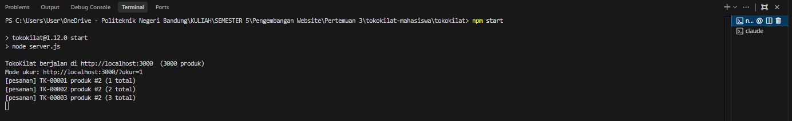

# Log prediksi

Aturan: satu entri per masalah. Bagian **Sebelum perbaikan** harus di-commit *sebelum* commit
perbaikannya. Bagian **Sesudah perbaikan** diisi setelah pengukuran ulang. Jangan menyunting
bagian "sebelum" setelah hasilnya diketahui; bila prediksi meleset, jelaskan di bagian "sesudah".

---

## P-01: [judul singkat masalah]

**Tiket terkait:** TK-....
**Tanggal dan hash commit entri ini:** ....

### Sebelum perbaikan

- **Yang teramati di trace (baseline):** durasi, di track apa, fungsi apa yang dominan di bottom-up.
- **Dugaan mekanisme:** jelaskan memakai istilah event loop (task, microtask, rendering opportunity)
  atau tahap pipeline (JS, Style, Layout, Paint, Composite).
- **Rencana perubahan:** ....
- **Prediksi terukur:** "Setelah perubahan, [metrik] turun dari ... menjadi sekitar ..., karena ...".
  Sertakan juga prediksi efek samping: apa yang mungkin menjadi *lebih buruk*?
- **Alternatif yang dipertimbangkan dan alasan tidak dipilih:** ....

### Sesudah perbaikan

- **Hash commit perbaikan:** ....
- **Hasil ukur (median 3 kali):** ....
- **Prediksi vs kenyataan:** tepat, meleset, atau sebagian? Bila meleset, apa yang salah dari model mental Anda?
- **Efek samping yang muncul:** ....

---

## P-1052: Pesanan ganda saat "Beli sekarang" diklik berulang + UI tidak menandai sedang diproses (S3)

**Tiket terkait:** TK-1052 (berbagi pola akar masalah yang sama dengan TK-1044 pada `beliSekarang`/`tambahKeKeranjang`)
**Tanggal dan hash commit entri ini:** 2026-10-01, (hash diisi saat entri ini di-commit)

### Sebelum perbaikan

- **Yang teramati di trace (baseline):**
  - Pada terminal, output dari hasil melakukan klik 'beliSekarang' secara cepat sebanyak 3 kali adalah 3 pesanan
- **Dugaan mekanisme:**
  - Akar masalah pesanan ganda **bukan** API (membantah dugaan Rudi #2), melainkan tidak adanya *guard* selama `await`. `beliSekarang` bersifat `async`, tetapi status "sedang diproses" tidak diumumkan ke UI maupun dipakai menolak klik berikutnya. `await` hanya menjadwalkan sisa fungsi sebagai task/microtask; ia tidak mengunci penangan event klik.
  - `async`/`await` tidak mengeluarkan kerja CPU dari main thread (membantah dugaan Rudi #4). `await` hanya menyerahkan kontrol di titik penyerahan; kerja sinkron sebelumnya (`Lacak.kirim` atas payload 9000 item) tetap memblokir.
  - Hubungan event loop: klik → task (handler) → long task sinkron Lacak → *rendering opportunity* tertunda → pengguna tidak melihat umpan balik → klik lagi → task baru → `fetch` baru → pesanan baru.
- **Rencana perubahan:**
  1. Tambah *guard* `sedangMemproses`; disable tombol "Beli sekarang" (dan "+ Keranjang") segera saat klik, pulihkan setelah `fetch` selesai/gagal. Tampilkan status "Memproses pesanan…". → mencegah pesanan ganda dan memberi *user error protection* + *self-descriptiveness*.
  2. Pangkas payload `Lacak.kirim('begin_checkout', …)`: kirim ringkasan (id produk, jumlah, total, sumber) alih-alih `riwayat` 9000 item utuh. Aturan §5.1 mengizinkan mengubah *isi data* selama setiap event tetap terkirim dengan informasi yang masuk akal. → `JSON.stringify` & hash jauh lebih ringan, long task hilang.
  3. Terapkan pola yang sama pada `tambahKeKeranjang` yang juga mengirim `riwayat` utuh (TK-1044).
- **Prediksi terukur:**
  - Jumlah pesanan dari 3 klik: dari 3 → **1** (guard menolak klik ke-2/3 selama `await`).
  - INP klik "Beli sekarang": dari … ms → **< 200 ms** (payload Lacak jauh lebih kecil).
  - Long task selama interaksi: dari … ms → **tidak ada yang > 100 ms**.
  - Efek samping yang mungkin memburuk: bila guard hanya *disable* tanpa feedback visual, pengguna mengira tombol rusak (gejala persis TK-1044) → wajib disertai label/status. Trade-off: sedikit DOM tambahan; aman jika hanya teks/`opacity` (di compositor).
- **Alternatif yang dipertimbangkan dan alasan tidak dipilih:**
  - *Debounce global klik* (tolak klik berdekatan ≤ N ms): rapuh, bisa menolak klik sah pada produk berbeda; tidak menjelaskan status.
  - *Idempotency key di server*: di luar yurisdiksi (`server.js` tak boleh diubah, §5.1) dan tidak atasi UX "tombol mati".
  - *Pindahkan Lacak ke Web Worker*: ideal tapi §5.2 melarang library/bundler dan vendor tak boleh disentuh; kompleksitas pesan tidak sepadan. Memangkas payload lebih sederhana dan langsung mengenai akar masalah.

### Sesudah perbaikan

- **Hash commit perbaikan:** ....
- **Hasil ukur (median 3 kali):** ....
- **Prediksi vs kenyataan:** ....
- **Efek samping yang muncul:** ....

---

## P-1057: Voucher membekukan halaman; progres tidak bertahap; kolom cari mati selama perhitungan (S4)

**Tiket terkait:** TK-1057
**Tanggal dan hash commit entri ini:** 2026-10-01, (hash diisi saat entri ini di-commit)

### Sebelum perbaikan

- **Yang teramati di trace (baseline):**
  - Skenario S4: klik "Pakai voucher" `KILAT1212`, lalu ketik di kolom cari selama perhitungan berjalan.
  - Flame chart main thread penuh oleh `terapkanVoucher` → loop semua produk → `hitungHargaPromo` (memanggil `simulasiCicilan` **41×** per produk; `simulasiCicilan(harga)` loop tenor 1–24 dengan loop dalam 1–tenor ≈ O(300) per panggilan). Fungsi dominan di bottom-up: `simulasiCicilan` dan `hitungHargaPromo` di `public/js/harga-promo.js`.
  - Meskipun `terapkanVoucher` memakai `await hitungHargaPromo` per produk, **kerja sinkron `simulasiCicilan` tetap di main thread** → deretan long task. Titik `await` hanya memberi batas *microtask* antar produk; bila satu produk terlalu berat, tidak ada *rendering opportunity* → **progress bar tertahan di 0% lalu melompat selesai** (gejala "menghitung 0% terus lalu tiba-tiba selesai").
  - Karena main thread sibuk, event `input` dari kolom cari (`pencarian.js` → `terapkanSaringan`) **tertahan di antrean task** → ketikan tidak tampil → INP pencarian selama S4 sangat tinggi.
  - Angka konkret (isi dari tangkapan layar/alat ukur Anda): INP klik voucher ≈ … ms (diperkirakan > 1000 ms); progres: **tidak bertahap** (0% → selesai); kolom cari: **tidak responsif**.
- **Dugaan mekanisme:**
  - Membantah dugaan Rudi #4 ("voucher sudah `async`, harusnya aman"): `async`/`await` tidak mengeluarkan komputasi sinkron dari main thread. `await` hanya menjadwalkan sisa sebagai *microtask*; `simulasiCicilan` tetap memblokir. Bukti: long task di flame chart berimpit dengan `simulasiCicilan`, bukan hilang.
  - Mekanisme pipeline: tulisan *progress* diubah via DOM, tetapi Style/Layout/Paint tidak sempat berjalan karena main thread tidak pernah idle cukup lama untuk *rendering opportunity* → progres tidak tergambar bertahap.
  - Mekanisme event loop: ketukan keyboard masuk sebagai task `input`; antrean task tidak diproses selama komputasi voucher → ketikan menumpuk → INP meledak.
- **Rencana perubahan:**
  1. **Hitung sekali, pakai banyak:** `simulasiCicilan` per produk hanya bergantung pada `harga`. Precompute tabel cicilan untuk rentang harga diskrit (atau hitung `hitungHargaPromo` per produk tanpa memanggil `simulasiCicilan` 41×). Menghapus redundansi 41× panggilan memangkas komputasi berkali-kali.
  2. **Potong beban per *tick*:** bila tetap perlu loop semua produk, pecah menjadi batch kecil dengan `await` di tiap batch (atau `requestIdleCallback`/`setTimeout(0)`) agar ada *rendering opportunity* → progress benar-benar bertahap dan kolom cari tetap responsif.
  3. Pertahankan aturan bisnis voucher termasuk simulasi cicilan (§5.4) — hanya *cara menghitung & menjadwalkan* yang diubah, bukan rumus.
- **Prediksi terukur:**
  - INP klik voucher: dari … ms → **< 200 ms** (komputasi berkurang + tidak satu long task raksasa).
  - Progres: dari "0% lalu lompat selesai" → **tergambar bertahap** (rendering opportunity antar batch).
  - Kolom cari selama perhitungan: dari "mati" → **responsif** (INP ketik < 200 ms).
  - Long task selama interaksi: dari … ms → **tidak ada yang > 100 ms**.
  - Efek samping yang mungkin memburuk: memecah ke batch memperpanjang *wall-clock* total sedikit (trade-off latensi-vs-responsivitas); precompute tabel memakan sedikit memori tetap (trade-off *resource utilization*).
- **Alternatif yang dipertimbangkan dan alasan tidak dipilih:**
  - *Memindahkan `simulasiCicilan` ke Web Worker*: teknis bersih, tetapi §5.2 melarang library/bundler dan menambah kompleksitas pesan; precompute in-thread lebih sederhana dan cukup.
  - *Caching hasil voucher per harga*: sebagian tercakup oleh precompute tabel; cache murni tanpa mengurangi 41× panggilan tidak mengatasi long task pada harga baru.
  - *Menurunkan ketelitian simulasi (kurangi tenor)*: melanggar §5.4 (aturan bisnis cicilan harus tetap benar). Ditolak.

### Sesudah perbaikan

- **Hash commit perbaikan:** ....
- **Hasil ukur (median 3 kali):** ....
- **Prediksi vs kenyataan:** ....
- **Efek samping yang muncul:** ....
